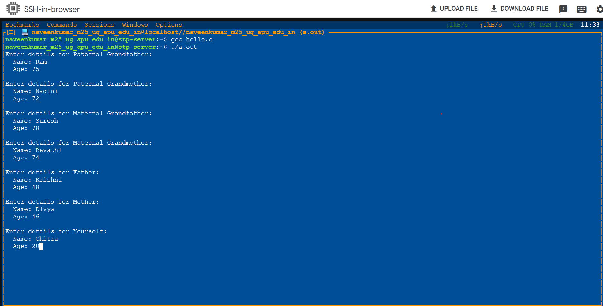
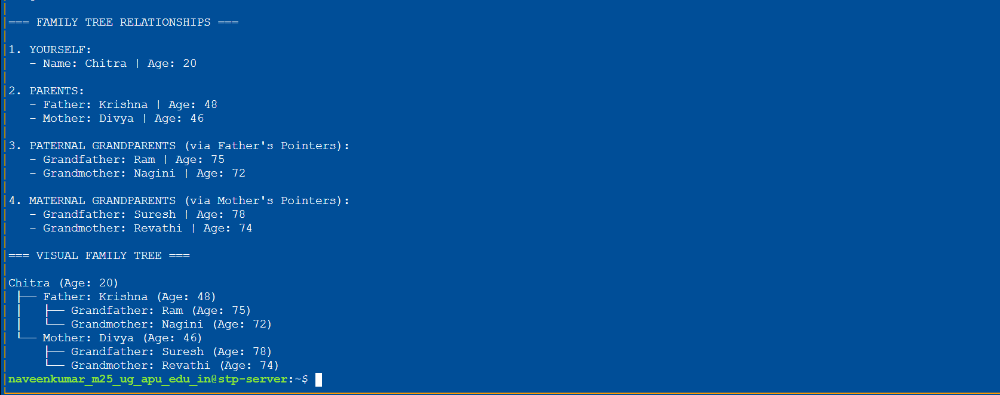
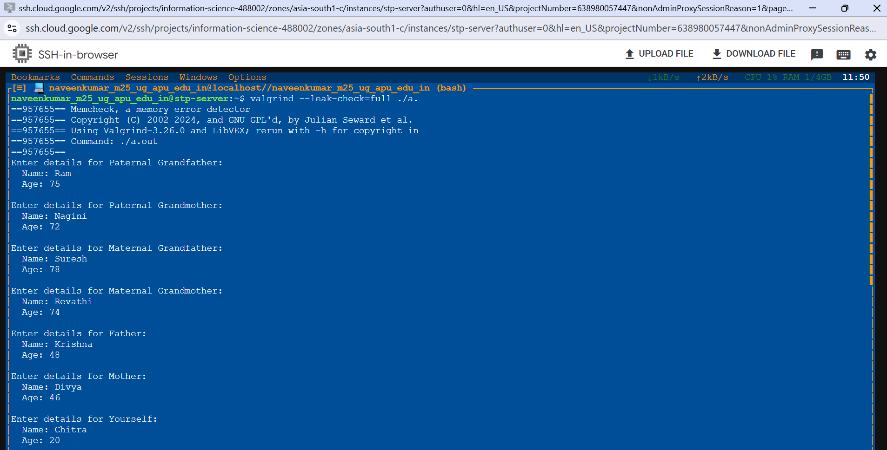
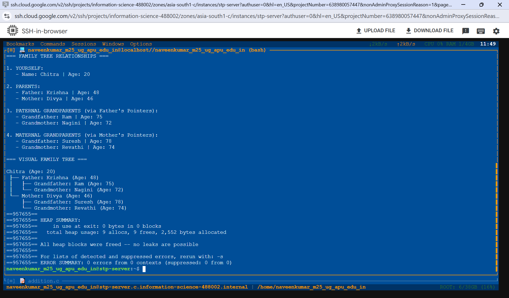

# Family Tree C Program (Shows the linkage of three generations)

## Program Description
This program built based on C language. It describes the three generation family tree consists of 7 people (Child, Parents(2), and  Grandparents(4). 

The program demonstrates **dynamic memory allocation (i.e) malloc()** and **pointer-based relationships**. To prevent data duplication, each person exists as a single struct instance in memory, and family connections are made exclusively by linking struct pointers (`father` and `mother`).

---
## How It Works

1. **Memory Allocation (`malloc`)**: Takes the names and ages of 7 family members and allocates memory for them. 
2. **Linking Parents (`link_parents`)**: Connects family members using pointers to represent parent-child relationships. 
3. **Displaying Output**: Uses pointers to display family relationships and the family tree.
4. **Visual Tree Hierarchy**: Uses **(`print_tree_visual()`)** to display the family tree with tree symbols. 
5. **Memory Cleanup (`free`)**: Frees the allocated memory after the program finishes. 

---

## Compilation, Execution and Check for memory leak

### 1. Compile the Program
To compile the program in the VM using Termide, Refer to the command below.

`gcc family_tree.c`

### 2. Execute the Program
To execute the program in the VM using Termide, Refer to the command below.

`./a.out`

### 3. Check for the memory leak
To check the memory leak of the program in the VM using Termide, Refer to the command below.

`valgrind --leak-check=full ./a.out`

## Screenshots
*Figure1: output of the collected information*

*Figure2: Displayed the collected information*

*Figure3: First half of  leak check*

*Figure4: Second half of leak check*

